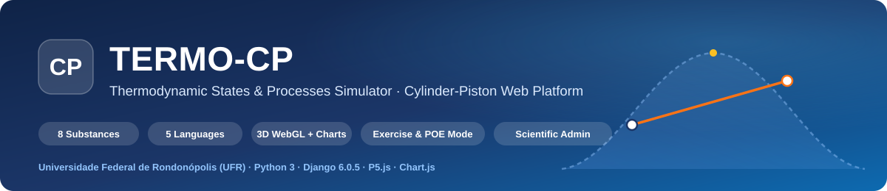
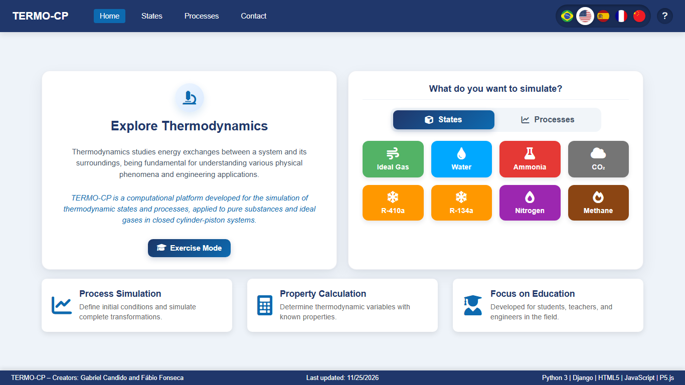

<a name="top"></a>
<p align="center">
  <a href="https://gcandid0.pythonanywhere.com/">
    
  </a>
</p>

<div align="center">

# TERMO-CP

### Web platform for simulating thermodynamic states and processes in piston-cylinder systems.

<sub><a href="./README.md">🇧🇷 Português</a> &nbsp;|&nbsp; 🇺🇸 English &nbsp;|&nbsp; <a href="./README.es.md">🇪🇸 Español</a> &nbsp;|&nbsp; <a href="./README.fr.md">🇫🇷 Français</a> &nbsp;|&nbsp; <a href="./README.zh.md">🇨🇳 中文 (简体)</a></sub>

<br/>

<a href="https://gcandid0.pythonanywhere.com/"></a>
<a href="https://www.djangoproject.com/"></a>
<a href="https://www.python.org/"></a>
<a href="https://p5js.org/"></a>
<a href="https://github.com/gcandid0/Termo-CP/blob/main/LICENSE"></a>

<br/>

<a href="https://github.com/gcandid0/Termo-CP/actions/workflows/tests.yml"></a>
<a href="https://github.com/gcandid0/Termo-CP"></a>
<a href="https://github.com/gcandid0/Termo-CP"></a>
<a href="https://github.com/gcandid0/Termo-CP"></a>
<a href="https://github.com/gcandid0/Termo-CP/stargazers"></a>

<br/><br/>

<a href="http://lattes.cnpq.br/6696786236047929"></a>
<a href="https://www.linkedin.com/in/gabriel-candido-235637226/"></a>
<a href="https://github.com/gcandid0/Termo-CP"></a>

</div>

<p align="center"><sub>Developed as part of academic research at the <strong>Federal University of Rondonópolis (UFR)</strong> · software registration pending with INPI (Brazil)</sub></p>

## Table of Contents

- [About TERMO-CP](#about-termo-cp)
- [Languages](#languages)
- [Supported Substances and Processes](#supported-substances-and-processes)
- [Features](#features)
- [Getting Started](#getting-started)
- [Testing and Code Quality](#testing-and-code-quality)
- [Tech Stack](#tech-stack)
- [Roadmap](#roadmap)
- [Contact](#contact)
- [Authors](#authors)
- [License](#license)
- [How to Cite](#how-to-cite)
- [Contributing](#contributing)

---

## About TERMO-CP

**TERMO-CP** is a computational web platform built for simulating thermodynamic **states** and **processes** of pure substances and ideal gases in closed piston-cylinder systems.

Designed with an educational focus, it helps students, professors, and engineers calculate thermodynamic properties, analyze 1st and 2nd Law balances, and visualize transformations quickly and interactively.

**Key highlights:**

- **Complete thermodynamic state calculation** — determines `P`, `T`, `v`, `u`, `h`, `s`, phase, and quality `x` (both `%` and decimal fraction) from any valid pair of known properties, with configurable system mass (`m` in kg).
- **Process simulation & cycle chaining** — computes full transformations including work (`W`), heat (`Q`), entropy generation (`Sgen`), 2nd Law feasibility check, and **Global Cycle Balance** (`W_net`, `Q_H`, `Q_L`, thermal efficiency `η`, and `COP`).
- **Interactive diagrams with Zoom & Pan** — `P-v`, `T-s`, `h-s`, `T-v`, and `P-h` plots (linear and logarithmic axes) with saturation dome, critical point, and PNG/PDF/CSV export.
- **Didactic calculation memorial (vector PDF)** — step-by-step derivations, State 1 × State 2 table, 1st Law check, Gouy-Stodola irreversibility, and A4 PDF export.
- **Exercise Mode & Mini-Exam** — randomized problems by substance and level, 3-question Mini-Exam, anti-cheating lock, quick unit converter, authenticity code, and PDF receipt.
- **Shareable simulations** — short link (`/s/<code>/`) and QR Code with 3D cylinder preview (including volume scale) and one-click live reopening in TERMO-CP.
- **Interactive 3D visualization** — WebGL piston-cylinder animation in P5.js with logarithmic volume scale.
- **History, reports, Guided Tour & Admin analytics** — side-by-side comparison, PDF/CSV/PNG exports, interactive tour, and anonymous usage statistics.

<br>

<div align="center">
  <a href="https://gcandid0.pythonanywhere.com/">
    
  </a>
</div>

<p align="right"><a href="#top">↑ back to top</a></p>

## Languages

The platform is available in **5 languages**, selectable directly from the top navigation bar (with browser preference persistence):

🇧🇷 **Português** &nbsp;|&nbsp; 🇺🇸 **English** &nbsp;|&nbsp; 🇪🇸 **Español** &nbsp;|&nbsp; 🇫🇷 **Français** &nbsp;|&nbsp; 🇨🇳 **中文 (简体)**

<p align="right"><a href="#top">↑ back to top</a></p>

## Supported Substances and Processes

| Substance | States | Isobaric (`P = const`) | Isochoric (`v = const`) | Isentropic (`s = const`) | Isothermal (`T = const`) | Polytropic (`pvⁿ = const`) |
|---|:---:|:---:|:---:|:---:|:---:|:---:|
| **Ideal Gas** | ✅ | ✅ | ✅ | ✅ | ✅ | ✅ |
| **Water** | ✅ | ✅ | ✅ | ✅ | — | — |
| **Ammonia** | ✅ | ✅ | ✅ | ✅ | — | — |
| **CO₂** | ✅ | ✅ | ✅ | ✅ | — | — |
| **R-410A** | ✅ | ✅ | ✅ | ✅ | — | — |
| **R-134a** | ✅ | ✅ | ✅ | ✅ | — | — |
| **Nitrogen** | ✅ | ✅ | ✅ | ✅ | — | — |
| **Methane** | ✅ | ✅ | ✅ | ✅ | — | — |

<p align="right"><a href="#top">↑ back to top</a></p>

---

## Features

### State Simulation
Enter the system mass and two known properties of a substance (pressure, temperature, specific volume, internal energy, enthalpy, entropy, or quality). TERMO-CP automatically validates physical bounds against each substance's thermodynamic tables, shows the valid range in real time, and computes all remaining properties.

### Process & Cycle Simulation
Define the mass, initial state, process type, and final condition (or heat transfer) to obtain the final state, `W`, `Q`, and `Sgen` with automatic 2nd Law diagnostics. Multiple consecutive processes can be chained to compute the **Global Cycle Balance** (`W_net`, `Q_H`, `Q_L`, `η`, and `COP`).

### 3D Visualization & Interactive Diagrams
Every result includes a 3D P5.js piston-cylinder animation (visually distinguishing liquid, vapor, and two-phase mixtures) alongside interactive thermodynamic diagrams featuring the saturation dome and critical point.

### Didactic Memorial, History & Reports
- **Calculation Memorial (PDF)**: step-by-step 1st & 2nd Law derivations, numerical check (`Q − W = ΔU`), Gouy-Stodola irreversibility (`I = T_surr · Sgen`), and vector A4 PDF export.
- **Zoom & Pan Diagrams**: native Chart.js zoom and drag on both linear and logarithmic axes, with PNG, PDF, and CSV export.
- **History & Comparison**: stores session calculations with search filter and side-by-side comparison.

### Exercise Mode & Shareable Simulations
- **Exercise Mode (`/exercicios/`)**: randomized problems calibrated per substance (or 3-question Mini-Exam), clickable physical prediction chips, anti-cheating lock, unit converter, sign convention guide, server authenticity code, and PDF receipt.
- **Shareable Links (`/s/<code>/`)**: short link, QR Code, and WhatsApp/email sharing with 3D cylinder preview (with scale) and one-click live simulation restore.

<p align="right"><a href="#top">↑ back to top</a></p>

---

## Getting Started

> [!IMPORTANT]
> The source code in this repository is made available strictly for **viewing and academic study**, under the current [license](#license). To run locally for research/evaluation:

**Prerequisites:**
- Python 3.10+
- pip

### Local installation

```bash
# Clone the repository
git clone https://github.com/gcandid0/Termo-CP.git
cd Termo-CP

# Create and activate a virtual environment
python3 -m venv venv
source venv/bin/activate      # Linux / macOS
# venv\Scripts\activate       # Windows (PowerShell/CMD)

# Install dependencies
pip install -r requirements.txt

# Configure environment variables (.env)
# create a .env file at the project root with:
# SECRET_KEY=<your-secret-key>
# DEBUG=True

# Run migrations and start the development server
python manage.py migrate
python manage.py runserver
```

Open `http://127.0.0.1:8000/` in your browser.

**Core dependencies** (`requirements.txt`):

| Package | Version |
|---|---|
| Django | 6.0.5 |
| asgiref | 3.11.1 |
| python-dotenv | 1.2.2 |
| sqlparse | 0.5.5 |
| tzdata | 2026.2 |
| whitenoise | 6.12.0 |

### Online access

No installation required — use the live deployment directly:

**[gcandid0.pythonanywhere.com →](https://gcandid0.pythonanywhere.com/)**

<p align="right"><a href="#top">↑ back to top</a></p>

---

## Testing and Code Quality

This repository includes an automated test suite (Django `TestCase`) and static analysis with **Ruff**, running automatically via GitHub Actions:

```bash
# Run automated tests (36 tests: thermodynamics, views, forms, and UTF-8 integrity)
python manage.py test myapp

# Run Django system checks
python manage.py check

# Run Ruff linter (if installed)
ruff check myapp termocp
```

<p align="right"><a href="#top">↑ back to top</a></p>

---

## Tech Stack

- **Backend:** Python 3 + Django 6.0.5 + WhiteNoise
- **Frontend:** HTML5, CSS3, JavaScript, P5.js (WebGL), Chart.js, html2canvas
- **Quality & CI:** Django Test Suite + Ruff + GitHub Actions
- **Deployment:** PythonAnywhere
- **Configuration:** python-dotenv (`.env` with `SECRET_KEY` and `DEBUG`)

<p align="right"><a href="#top">↑ back to top</a></p>

---

## Roadmap

- [x] State calculation for 8 substances with exact table-bound validation
- [x] Process simulation with 3D piston-cylinder animation
- [x] Interactive thermodynamic diagrams (`P-v`, `T-s`, `h-s`, `T-v`, `P-h`) with saturation dome
- [x] Step-by-step didactic calculation memorial and 2nd Law check
- [x] Process chaining and Global Cycle Balance (`W_net`, `Q_H`, `Q_L`, `η`, `COP`)
- [x] Report export (`html2canvas`) and side-by-side calculation history
- [x] Help Center, contextual page help, and interactive Guided Tour
- [x] Full 5-language support (PT / EN / ES / FR / ZH)
- [x] Automated test suite and GitHub Actions CI pipeline
- [x] Diagram Zoom & Pan and vector PDF export for the Didactic Calculation Memorial
- [x] Exercise Mode (single & 3-question Mini-Exam) with anti-cheating lock and PDF receipt
- [x] Shareable simulation links (QR Code, scaled 3D preview, and live session restore)
- [x] Anonymous usage analytics and exercise audit logs in Django Admin
- [x] Exercise Mode with 3 tracks (Single, Mini-Exam, and Full POE Method), Class Code, Linear Interpolation Calculator, and Public Receipt Validator (`/exercicios/validar/`)
- [x] Scientific Django Admin Dashboard (6 labeled PNG charts, auto-generated paper summary, Word/LaTeX tables, and class filter)
- [x] Security hardening (API CSRF enforcement, rate limiting, honeypot, HTTPS/HSTS, configurable `ADMIN_URL`, and `pip-audit` in CI)
- [x] Full Mobile responsiveness (compact 2-row header, 3D results, and fullscreen Final Report modal)

<p align="right"><a href="#top">↑ back to top</a></p>

---

## Contact

Questions, suggestions, or bug reports can be submitted through the platform's [contact form](https://gcandid0.pythonanywhere.com/contato/), via [GitHub issues](https://github.com/gcandid0/Termo-CP/issues), or directly through the emails below.

## Authors

Developed within academic research at the **Federal University of Rondonópolis (UFR)**:

- **Gabriel Candido Messias dos Santos** — [gabrielcandidomds@gmail.com](mailto:gabrielcandidomds@gmail.com) · [Lattes](http://lattes.cnpq.br/6696786236047929) · [LinkedIn](https://www.linkedin.com/in/gabriel-candido-235637226/)
- **Fábio Basaglia Fonseca** — [fabio.fonseca@ufr.edu.br](mailto:fabio.fonseca@ufr.edu.br) · [Lattes](http://lattes.cnpq.br/4673164208199862)

## License

TERMO-CP is currently **pending software registration with INPI** (Brazilian Laws No. 9.609/1998 and No. 9.610/1998), with all copyrights reserved to the authors and UFR.

Until registration is finalized and formal licensing terms are defined:

- ✅ **Viewing and studying** the source code for non-commercial academic, research, and evaluation purposes is permitted.
- ❌ Without express written authorization from the authors, you **may not**: reproduce, distribute, modify, create derivative works, use commercially, sublicense, or assign rights.

The software is provided "as is", without warranty of any kind. See the full text in [LICENSE](LICENSE).

## How to Cite

If you use TERMO-CP in academic work, you may cite it in the following formats:

<details>
<summary><strong>ABNT</strong></summary>

```
SANTOS, Gabriel Candido Messias dos; FONSECA, Fábio Basaglia. TERMO-CP:
plataforma computacional para simulação de estados e processos termodinâmicos.
Rondonópolis: Universidade Federal de Rondonópolis (UFR), <year>. Available
at: https://gcandid0.pythonanywhere.com/. Accessed on: <date>.
```
</details>

<details>
<summary><strong>APA</strong></summary>

```
Santos, G. C. M., & Fonseca, F. B. (<year>). TERMO-CP: computational platform
for simulating thermodynamic states and processes [Software]. Federal University
of Rondonópolis. https://gcandid0.pythonanywhere.com/
```
</details>

<details>
<summary><strong>Vancouver</strong></summary>

```
Santos GCM, Fonseca FB. TERMO-CP: computational platform for simulating
thermodynamic states and processes [Internet]. Rondonópolis: Federal University
of Rondonópolis; <year> [cited <date>]. Available from:
https://gcandid0.pythonanywhere.com/
```
</details>

<details>
<summary><strong>IEEE</strong></summary>

```
G. C. M. Santos and F. B. Fonseca, "TERMO-CP: computational platform for
simulating thermodynamic states and processes," Federal University of
Rondonópolis (UFR), <year>. [Online]. Available:
https://gcandid0.pythonanywhere.com/
```
</details>

<details>
<summary><strong>BibTeX</strong></summary>

```bibtex
@software{termo_cp,
  author  = {Santos, Gabriel Candido Messias dos and Fonseca, Fábio Basaglia},
  title   = {TERMO-CP: computational platform for simulating thermodynamic
             states and processes},
  year    = {<year>},
  institution = {Federal University of Rondonópolis (UFR)},
  url     = {https://gcandid0.pythonanywhere.com/},
  note    = {Accessed on: <date>}
}
```
</details>

<details>
<summary><strong>RIS</strong> (Zotero, Mendeley, EndNote)</summary>

```
TY  - COMP
AU  - Santos, Gabriel Candido Messias dos
AU  - Fonseca, Fábio Basaglia
TI  - TERMO-CP: computational platform for simulating thermodynamic states and processes
PY  - <year>
PB  - Federal University of Rondonópolis (UFR)
UR  - https://gcandid0.pythonanywhere.com/
ER  -
```
</details>

## Contributing

Contributions are welcome under the terms of the [license](#license) — please contact the authors before proposing code changes. See the full guide in [CONTRIBUTING.md](CONTRIBUTING.md).

<p align="right"><a href="#top">↑ back to top</a></p>

---

> [!WARNING]
> TERMO-CP is intended for educational use and results should be validated before critical engineering applications. The software is pending registration with INPI and is distributed under restrictive terms — consult the [License](#license) before any use beyond viewing and study.

<br>

<div align="center">
  
  <br>
  <sub>
    <strong>TERMO-CP</strong> · developed at <a href="https://www.ufr.edu.br/">Federal University of Rondonópolis (UFR)</a><br>
    <a href="https://gcandid0.pythonanywhere.com/">Platform</a> ·
    <a href="https://github.com/gcandid0/Termo-CP">GitHub</a> ·
    <a href="http://lattes.cnpq.br/6696786236047929">Lattes</a> ·
    <a href="https://www.linkedin.com/in/gabriel-candido-235637226/">LinkedIn</a> ·
    <a href="mailto:gabrielcandidomds@gmail.com">Contact</a>
  </sub>
</div>
