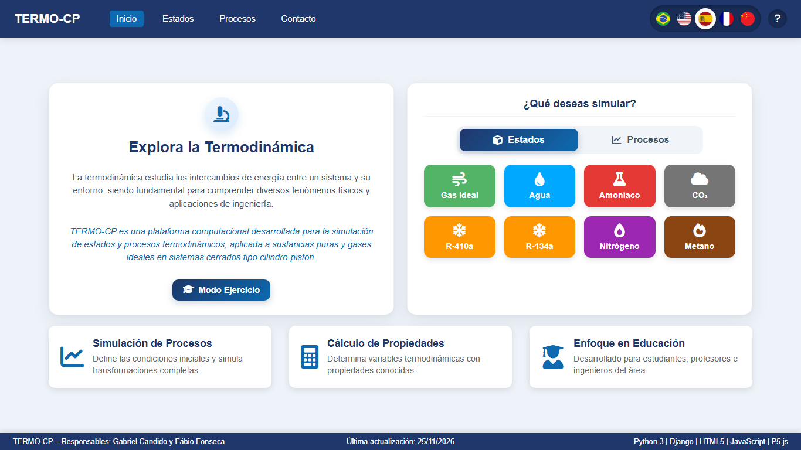

<a name="inicio"></a>
<p align="center">
  <a href="https://gcandid0.pythonanywhere.com/">
    
  </a>
</p>

<div align="center">

# TERMO-CP

### Plataforma web para la simulación de estados y procesos termodinámicos en sistemas cilindro-pistón.

<sub><a href="./README.md">🇧🇷 Português</a> &nbsp;|&nbsp; <a href="./README.en.md">🇺🇸 English</a> &nbsp;|&nbsp; 🇪🇸 Español &nbsp;|&nbsp; <a href="./README.fr.md">🇫🇷 Français</a> &nbsp;|&nbsp; <a href="./README.zh.md">🇨🇳 中文 (简体)</a></sub>

<br/>

<a href="https://gcandid0.pythonanywhere.com/"></a>
<a href="https://www.djangoproject.com/"></a>
<a href="https://www.python.org/"></a>
<a href="https://p5js.org/"></a>
<a href="https://github.com/gcandid0/Termo-CP/blob/main/LICENSE"></a>

<br/>

<a href="https://github.com/gcandid0/Termo-CP/actions/workflows/tests.yml"></a>
<a href="https://github.com/gcandid0/Termo-CP/stargazers"></a>
<a href="https://github.com/gcandid0/Termo-CP/commits/main"></a>
<a href="https://github.com/gcandid0/Termo-CP"></a>
<a href="https://github.com/gcandid0/Termo-CP/issues"></a>

<br/><br/>

<a href="http://lattes.cnpq.br/6696786236047929"></a>
<a href="https://www.linkedin.com/in/gabriel-candido-235637226/"></a>
<a href="https://github.com/gcandid0/Termo-CP"></a>

</div>

<p align="center"><sub>Desarrollado en el ámbito de investigación académica de la <strong>Universidad Federal de Rondonópolis (UFR)</strong> · en proceso de registro ante el INPI (Brasil)</sub></p>

## Índice

- [Acerca de TERMO-CP](#acerca-de-termo-cp)
- [Idiomas](#idiomas)
- [Sustancias y Procesos Soportados](#sustancias-y-procesos-soportados)
- [Funcionalidades](#funcionalidades)
- [Cómo usar](#cómo-usar)
- [Pruebas y Calidad de Código](#pruebas-y-calidad-de-código)
- [Stack Tecnológico](#stack-tecnológico)
- [Hoja de ruta](#hoja-de-ruta)
- [Contacto](#contacto)
- [Autores](#autores)
- [Licencia](#licencia)
- [Cómo citar](#cómo-citar)
- [Contribuir](#contribuir)

---

## Acerca de TERMO-CP

**TERMO-CP** es una plataforma computacional web desarrollada para simular **estados** y **procesos termodinámicos** de sustancias puras y gases ideales en sistemas cerrados de tipo cilindro-pistón.

Con un enfoque educativo, está dirigida a estudiantes, docentes e ingenieros que necesitan calcular propiedades termodinámicas, analizar balances de la 1ª y 2ª Leyes de la Termodinámica y visualizar transformaciones de manera rápida e interactiva.

**Aspectos destacados:**

- **Cálculo completo de estados termodinámicos** — determina `P`, `T`, `v`, `u`, `h`, `s`, fase y calidad `x` (en `%` y fracción decimal) a partir de pares de propiedades conocidas, con masa configurable (`m` en kg).
- **Simulación de procesos y encadenamiento de ciclos** — calcula transformaciones completas con trabajo (`W`), calor (`Q`), generación de entropía (`Sgen`), verificación de la 2ª Ley y **Balance Global del Ciclo** (`W_neto`, `Q_H`, `Q_L`, eficiencia térmica `η` y `COP`).
- **Diagramas interactivos con Zoom y Pan** — gráficos `P-v`, `T-s`, `h-s`, `T-v` y `P-h` (ejes lineales y logarítmicos) con domo de saturación, punto crítico y exportación en PNG/PDF/CSV.
- **Memoria de cálculo didáctica en PDF** — deducciones paso a paso, tabla Estado 1 × Estado 2, verificación de la 1ª Ley, irreversibilidad de Gouy-Stodola y PDF vectorial A4.
- **Modo Ejercicio y Mini-Examen** — problemas aleatorios por sustancia y nivel, Mini-Examen de 3 preguntas, bloqueo anti-trampa, conversor rápido, código de autenticidad y comprobante PDF.
- **Simulaciones compartibles** — enlace corto (`/s/<codigo>/`) y código QR con vista previa del cilindro 3D con escala y reapertura directa en TERMO-CP.
- **Visualización 3D interactiva** — animación WebGL del cilindro-pistón en P5.js con escala logarítmica de volumen.
- **Historial, informes, Tour Guiado y estadísticas** — comparación lado a lado, exportación PDF/CSV/PNG, recorrido interactivo y estadísticas anónimas en Django Admin.

<br>

<div align="center">
  <a href="https://gcandid0.pythonanywhere.com/">
    
  </a>
</div>

<p align="right"><a href="#inicio">↑ volver arriba</a></p>

## Idiomas

La plataforma está disponible en **5 idiomas**, seleccionables directamente desde el menú superior (con preferencia guardada en el navegador):

🇧🇷 **Português** &nbsp;|&nbsp; 🇺🇸 **English** &nbsp;|&nbsp; 🇪🇸 **Español** &nbsp;|&nbsp; 🇫🇷 **Français** &nbsp;|&nbsp; 🇨🇳 **中文 (简体)**

<p align="right"><a href="#inicio">↑ volver arriba</a></p>

## Sustancias y Procesos Soportados

| Sustancia | Estados | Isobárico (`P = cte`) | Isocórico (`v = cte`) | Isentrópico (`s = cte`) | Isotérmico (`T = cte`) | Politrópico (`pvⁿ = cte`) |
|---|:---:|:---:|:---:|:---:|:---:|:---:|
| **Gas Ideal** | ✅ | ✅ | ✅ | ✅ | ✅ | ✅ |
| **Agua** | ✅ | ✅ | ✅ | ✅ | — | — |
| **Amoníaco** | ✅ | ✅ | ✅ | ✅ | — | — |
| **CO₂** | ✅ | ✅ | ✅ | ✅ | — | — |
| **R-410A** | ✅ | ✅ | ✅ | ✅ | — | — |
| **R-134a** | ✅ | ✅ | ✅ | ✅ | — | — |
| **Nitrógeno** | ✅ | ✅ | ✅ | ✅ | — | — |
| **Metano** | ✅ | ✅ | ✅ | ✅ | — | — |

<p align="right"><a href="#inicio">↑ volver arriba</a></p>

---

## Funcionalidades

### Simulación de Estados
Ingrese la masa del sistema y dos propiedades conocidas de una sustancia (presión, temperatura, volumen específico, energía interna, entalpía, entropía o calidad). TERMO-CP valida automáticamente los límites físicos de cada tabla termodinámica, muestra el rango válido en tiempo real y calcula todas las demás propiedades.

### Simulación de Procesos y Ciclos
Defina la masa, el estado inicial, el tipo de proceso y la condición final (o el calor transferido) para obtener el estado final, `W`, `Q` y `Sgen` con diagnóstico automático por la 2ª Ley de la Termodinámica. Permite encadenar múltiples procesos consecutivos para analizar el **balance global del ciclo** (`W_neto`, `Q_H`, `Q_L`, `η` y `COP`).

### Visualización 3D y Diagramas Interactivos
Cada resultado incluye una animación 3D del cilindro-pistón en P5.js (distinguiendo visualmente líquido, vapor y mezcla bifásica) junto con diagramas termodinámicos interactivos con domo de saturación y punto crítico.

### Memoria Didáctica, Historial e Informes
- **Memoria de Cálculo (PDF)**: deducciones paso a paso de la 1ª y 2ª Ley, verificación numérica (`Q − W = ΔU`), irreversibilidad de Gouy-Stodola y exportación vectorial en PDF A4.
- **Diagramas con Zoom y Pan**: zoom y arrastre nativos en Chart.js (ejes lineales y logarítmicos), con exportación en PNG, PDF y CSV.
- **Historial y Comparación**: guarda los cálculos de la sesión con filtro de búsqueda y comparación lado a lado.

### Modo Ejercicio y Enlaces Compartibles
- **Modo Ejercicio (`/exercicios/`)**: problemas aleatorios calibrados por sustancia (o Mini-Examen de 3 preguntas), chips de análisis físico, bloqueo anti-trampa, conversor rápido, guía de signos, código de autenticidad y comprobante/boletín en PDF.
- **Enlaces Compartibles (`/s/<codigo>/`)**: enlace corto, código QR y vista previa 3D con escala para reabrir la simulación lista en TERMO-CP.

<p align="right"><a href="#inicio">↑ volver arriba</a></p>

---

## Cómo usar

> [!IMPORTANT]
> El código fuente de este repositorio se ofrece únicamente para **visualización y estudio académico**, conforme a la [licencia](#licencia) vigente. Para ejecutarlo localmente con fines de investigación/evaluación:

**Requisitos previos:**
- Python 3.10+
- pip

### Instalación local

```bash
# Clonar el repositorio
git clone https://github.com/gcandid0/Termo-CP.git
cd Termo-CP

# Crear y activar un entorno virtual
python3 -m venv venv
source venv/bin/activate      # Linux / macOS
# venv\Scripts\activate       # Windows (PowerShell/CMD)

# Instalar dependencias
pip install -r requirements.txt

# Configurar variables de entorno (.env)
# cree un archivo .env en la raíz con:
# SECRET_KEY=<su-clave>
# DEBUG=True

# Ejecutar migraciones e iniciar el servidor
python manage.py migrate
python manage.py runserver
```

Abra `http://127.0.0.1:8000/` en el navegador.

**Dependencias principales** (`requirements.txt`):

| Paquete | Versión |
|---|---|
| Django | 6.0.5 |
| asgiref | 3.11.1 |
| python-dotenv | 1.2.2 |
| sqlparse | 0.5.5 |
| tzdata | 2026.2 |
| whitenoise | 6.12.0 |

### Acceso en línea

No requiere instalación — acceda directamente a la versión publicada:

**[gcandid0.pythonanywhere.com →](https://gcandid0.pythonanywhere.com/)**

<p align="right"><a href="#inicio">↑ volver arriba</a></p>

---

## Pruebas y Calidad de Código

El repositorio cuenta con una suite automatizada de pruebas (Django `TestCase`) y análisis estático con **Ruff**, ejecutados automáticamente mediante GitHub Actions:

```bash
# Ejecutar pruebas automatizadas (33 pruebas: cálculos, vistas, formularios e integridad UTF-8)
python manage.py test myapp

# Verificación del proyecto Django
python manage.py check

# Análisis estático con Ruff (si está instalado)
ruff check myapp termocp
```

<p align="right"><a href="#inicio">↑ volver arriba</a></p>

---

## Stack Tecnológico

- **Backend:** Python 3 + Django 6.0.5 + WhiteNoise
- **Frontend:** HTML5, CSS3, JavaScript, P5.js (WebGL), Chart.js, html2canvas
- **Calidad y CI:** Django Test Suite + Ruff + GitHub Actions
- **Despliegue:** PythonAnywhere
- **Configuración:** python-dotenv (`.env` con `SECRET_KEY` y `DEBUG`)

<p align="right"><a href="#inicio">↑ volver arriba</a></p>

---

## Hoja de ruta

- [x] Cálculo de estados para 8 sustancias con validación según los límites exactos de las tablas
- [x] Simulación de procesos con animación 3D del cilindro-pistón
- [x] Diagramas termodinámicos interactivos (`P-v`, `T-s`, `h-s`, `T-v`, `P-h`) con domo de saturación
- [x] Memoria de cálculo didáctica paso a paso y verificación de la 2ª Ley
- [x] Encadenamiento de procesos y Balance Global del Ciclo (`W_neto`, `Q_H`, `Q_L`, `η`, `COP`)
- [x] Exportación de informes (`html2canvas`) e historial comparativo de cálculos
- [x] Centro de Ayuda, ayuda contextual y Tour Guiado interactivo
- [x] Soporte completo en 5 idiomas (PT / EN / ES / FR / ZH)
- [x] Suite de pruebas automatizadas y pipeline CI con GitHub Actions
- [x] Zoom y Pan en diagramas y exportación vectorial en PDF de la Memoria Didáctica
- [x] Modo Ejercicio (individual y Mini-Examen de 3 preguntas) con bloqueo anti-trampa y PDF
- [x] Enlaces compartibles de simulación (código QR, vista previa 3D con escala y reapertura directa)
- [x] Estadísticas anónimas de uso y registro de ejercicios en Django Admin

<p align="right"><a href="#inicio">↑ volver arriba</a></p>

---

## Contacto

Dudas, sugerencias o reportes de errores pueden enviarse mediante el [formulario de contacto](https://gcandid0.pythonanywhere.com/contato/) de la plataforma, a través de [issues en GitHub](https://github.com/gcandid0/Termo-CP/issues) o directamente a los correos electrónicos indicados abajo.

## Autores

Proyecto desarrollado en el ámbito de investigación académica de la **Universidad Federal de Rondonópolis (UFR)**:

- **Gabriel Candido Messias dos Santos** — [gabrielcandidomds@gmail.com](mailto:gabrielcandidomds@gmail.com) · [Lattes](http://lattes.cnpq.br/6696786236047929) · [LinkedIn](https://www.linkedin.com/in/gabriel-candido-235637226/)
- **Fábio Basaglia Fonseca** — [fabio.fonseca@ufr.edu.br](mailto:fabio.fonseca@ufr.edu.br) · [Lattes](http://lattes.cnpq.br/4673164208199862)

## Licencia

TERMO-CP se encuentra en **proceso de registro ante el INPI** (Leyes brasileñas nº 9.609/1998 y nº 9.610/1998), con todos los derechos de autor reservados a los autores y a la UFR.

Hasta que finalice el registro y se definan los términos formales de licenciamiento:

- ✅ Se permite la **visualización y el estudio** del código fuente con fines académicos, de investigación y evaluación, sin fines comerciales.
- ❌ **No se permite**, sin autorización expresa y por escrito de los autores: reproducción, distribución, modificación, creación de obras derivadas, uso comercial, sublicencia o cesión de derechos.

El software se proporciona "tal cual", sin garantías de ningún tipo. Consulte el texto completo en [LICENSE](LICENSE).

## Cómo citar

Si utiliza TERMO-CP en trabajos académicos, puede citarlo en los siguientes formatos:

<details>
<summary><strong>ABNT</strong></summary>

```
SANTOS, Gabriel Candido Messias dos; FONSECA, Fábio Basaglia. TERMO-CP:
plataforma computacional para simulação de estados e processos termodinâmicos.
Rondonópolis: Universidade Federal de Rondonópolis (UFR), <año>. Disponible
en: https://gcandid0.pythonanywhere.com/. Acceso en: <fecha>.
```
</details>

<details>
<summary><strong>APA</strong></summary>

```
Santos, G. C. M., & Fonseca, F. B. (<año>). TERMO-CP: plataforma computacional
para simulación de estados y procesos termodinámicos [Software]. Universidad
Federal de Rondonópolis. https://gcandid0.pythonanywhere.com/
```
</details>

<details>
<summary><strong>Vancouver</strong></summary>

```
Santos GCM, Fonseca FB. TERMO-CP: plataforma computacional para simulación de
estados y procesos termodinámicos [Internet]. Rondonópolis: Universidad Federal
de Rondonópolis; <año> [citado <fecha>]. Disponible en:
https://gcandid0.pythonanywhere.com/
```
</details>

<details>
<summary><strong>IEEE</strong></summary>

```
G. C. M. Santos and F. B. Fonseca, "TERMO-CP: plataforma computacional para
simulación de estados y procesos termodinámicos," Universidad Federal de
Rondonópolis (UFR), <año>. [En línea]. Disponible:
https://gcandid0.pythonanywhere.com/
```
</details>

<details>
<summary><strong>BibTeX</strong></summary>

```bibtex
@software{termo_cp,
  author  = {Santos, Gabriel Candido Messias dos and Fonseca, Fábio Basaglia},
  title   = {TERMO-CP: plataforma computacional para simulación de estados y
             procesos termodinámicos},
  year    = {<año>},
  institution = {Universidad Federal de Rondonópolis (UFR)},
  url     = {https://gcandid0.pythonanywhere.com/},
  note    = {Acceso en: <fecha>}
}
```
</details>

<details>
<summary><strong>RIS</strong> (Zotero, Mendeley, EndNote)</summary>

```
TY  - COMP
AU  - Santos, Gabriel Candido Messias dos
AU  - Fonseca, Fábio Basaglia
TI  - TERMO-CP: plataforma computacional para simulación de estados y procesos termodinámicos
PY  - <año>
PB  - Universidad Federal de Rondonópolis (UFR)
UR  - https://gcandid0.pythonanywhere.com/
ER  -
```
</details>

## Contribuir

Las contribuciones son bienvenidas respetando los términos de la [licencia](#licencia) — por favor, póngase en contacto con los autores antes de proponer cambios de código. Consulte la guía completa en [CONTRIBUTING.md](CONTRIBUTING.md).

<p align="right"><a href="#inicio">↑ volver arriba</a></p>

---

> [!WARNING]
> TERMO-CP tiene fines educativos y sus resultados deben validarse antes de aplicaciones críticas de ingeniería. El software está en proceso de registro ante el INPI y se distribuye bajo términos restrictivos — consulte la [Licencia](#licencia) antes de cualquier uso más allá de la visualización y el estudio.

<br>

<div align="center">
  
  <br>
  <sub>
    <strong>TERMO-CP</strong> · desarrollado en la <a href="https://www.ufr.edu.br/">Universidad Federal de Rondonópolis (UFR)</a><br>
    <a href="https://gcandid0.pythonanywhere.com/">Plataforma</a> ·
    <a href="https://github.com/gcandid0/Termo-CP">GitHub</a> ·
    <a href="http://lattes.cnpq.br/6696786236047929">Lattes</a> ·
    <a href="https://www.linkedin.com/in/gabriel-candido-235637226/">LinkedIn</a> ·
    <a href="mailto:gabrielcandidomds@gmail.com">Contacto</a>
  </sub>
</div>
