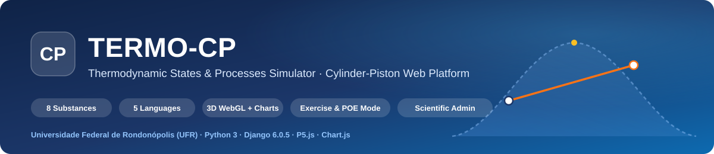
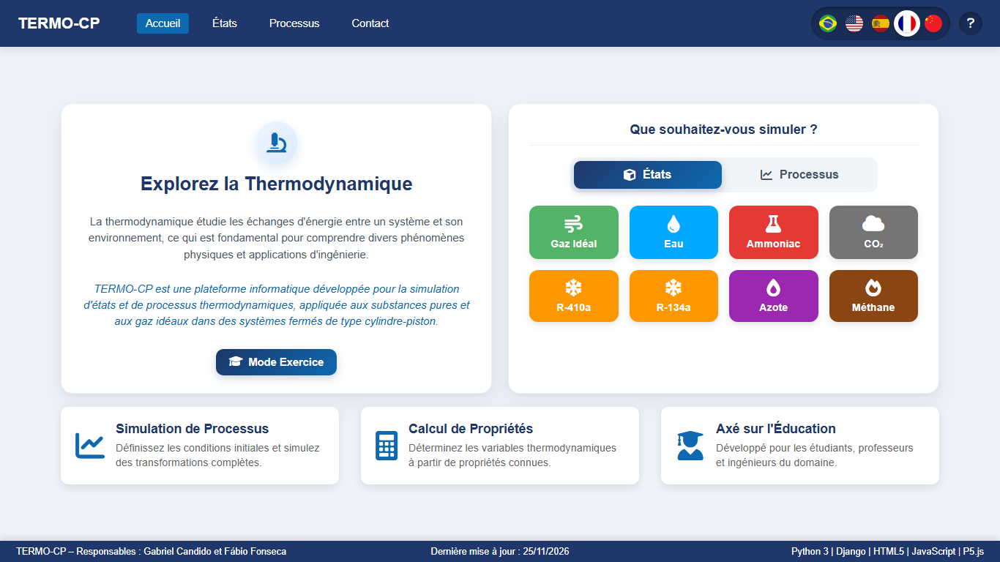

<a name="haut"></a>
<p align="center">
  <a href="https://gcandid0.pythonanywhere.com/">
    
  </a>
</p>

<div align="center">

# TERMO-CP

### Plateforme web pour la simulation d'états et de processus thermodynamiques dans des systèmes cylindre-piston.

<sub><a href="./README.md">🇧🇷 Português</a> &nbsp;|&nbsp; <a href="./README.en.md">🇺🇸 English</a> &nbsp;|&nbsp; <a href="./README.es.md">🇪🇸 Español</a> &nbsp;|&nbsp; 🇫🇷 Français &nbsp;|&nbsp; <a href="./README.zh.md">🇨🇳 中文 (简体)</a></sub>

<br/>

<a href="https://gcandid0.pythonanywhere.com/"></a>
<a href="https://www.djangoproject.com/"></a>
<a href="https://www.python.org/"></a>
<a href="https://p5js.org/"></a>
<a href="https://github.com/gcandid0/Termo-CP/blob/main/LICENSE"></a>

<br/>

<a href="https://github.com/gcandid0/Termo-CP/actions/workflows/tests.yml"></a>
<a href="https://github.com/gcandid0/Termo-CP"></a>
<a href="https://github.com/gcandid0/Termo-CP"></a>
<a href="https://github.com/gcandid0/Termo-CP"></a>
<a href="https://github.com/gcandid0/Termo-CP/stargazers"></a>

<br/><br/>

<a href="http://lattes.cnpq.br/6696786236047929"></a>
<a href="https://www.linkedin.com/in/gabriel-candido-235637226/"></a>
<a href="https://github.com/gcandid0/Termo-CP"></a>

</div>

<p align="center"><sub>Développé dans le cadre de recherches académiques à l'<strong>Université Fédérale de Rondonópolis (UFR)</strong> · en cours d'enregistrement auprès de l'INPI (Brésil)</sub></p>

## Sommaire

- [À propos de TERMO-CP](#à-propos-de-termo-cp)
- [Langues](#langues)
- [Substances et Processus Pris en Charge](#substances-et-processus-pris-en-charge)
- [Fonctionnalités](#fonctionnalités)
- [Comment utiliser](#comment-utiliser)
- [Tests et Qualité du Code](#tests-et-qualité-du-code)
- [Stack Technologique](#stack-technologique)
- [Feuille de route](#feuille-de-route)
- [Contact](#contact)
- [Auteurs](#auteurs)
- [Licence](#licence)
- [Comment citer](#comment-citer)
- [Contribuer](#contribuer)

---

## À propos de TERMO-CP

**TERMO-CP** est une plateforme web de calcul scientifique conçue pour simuler les **états** et **processus thermodynamiques** de substances pures et de gaz idéaux dans des systèmes fermés de type cylindre-piston.

Orienté vers l'enseignement et la recherche, le projet aide les étudiants, enseignants et ingénieurs à calculer des propriétés thermodynamiques, analyser les bilans des 1re et 2e Lois de la Thermodynamique et visualiser les transformations de façon rapide et interactive.

**Points forts :**

- **Calcul complet d'états thermodynamiques** — détermine `P`, `T`, `v`, `u`, `h`, `s`, la phase et le titre `x` (en `%` et en fraction décimale) à partir de paires de propriétés connues, avec masse configurable (`m` en kg).
- **Simulation de processus et enchaînement de cycles** — calcule des transformations complètes incluant le travail (`W`), la chaleur (`Q`), l'entropie générée (`Sgén`), la vérification de la 2e Loi et le **Bilan Global du Cycle** (`W_net`, `Q_H`, `Q_L`, rendement thermique `η` et `COP`).
- **Diagrammes interactifs avec Zoom & Pan** — tracés `P-v`, `T-s`, `h-s`, `T-v` et `P-h` (axes linéaires et logarithmiques) avec dôme de saturation, point critique et export PNG/PDF/CSV.
- **Mémoire didactique en PDF vectoriel** — démonstrations étape par étape, tableau État 1 × État 2, vérification de la 1re Loi, irréversibilité de Gouy-Stodola et export PDF A4.
- **Mode Exercice et Mini-Examen** — exercices aléatoires par substance et niveau, Mini-Examen de 3 questions, verrou anti-triche, convertisseur rapide, code d'authenticité et justificatif PDF.
- **Partage de simulations** — lien court (`/s/<code>/`) et QR Code avec aperçu 3D du cylindre (avec échelle) et réouverture directe dans TERMO-CP.
- **Visualisation 3D interactive** — animation WebGL du cylindre-piston avec P5.js et échelle logarithmique de volume.
- **Historique, rapports, Visite Guidée et statistiques** — comparaison côte à côte, export PDF/CSV/PNG, visite interactive et statistiques anonymes dans Django Admin.

<br>

<div align="center">
  <a href="https://gcandid0.pythonanywhere.com/">
    
  </a>
</div>

<p align="right"><a href="#haut">↑ retour en haut</a></p>

## Langues

La plateforme est disponible en **5 langues**, sélectionnables directement dans la barre supérieure (préférence enregistrée dans le navigateur) :

🇧🇷 **Português** &nbsp;|&nbsp; 🇺🇸 **English** &nbsp;|&nbsp; 🇪🇸 **Español** &nbsp;|&nbsp; 🇫🇷 **Français** &nbsp;|&nbsp; 🇨🇳 **中文 (简体)**

<p align="right"><a href="#haut">↑ retour en haut</a></p>

## Substances et Processus Pris en Charge

| Substance | États | Isobare (`P = cte`) | Isochore (`v = cte`) | Isentropique (`s = cte`) | Isotherme (`T = cte`) | Polytropique (`pvⁿ = cte`) |
|---|:---:|:---:|:---:|:---:|:---:|:---:|
| **Gaz Idéal** | ✅ | ✅ | ✅ | ✅ | ✅ | ✅ |
| **Eau** | ✅ | ✅ | ✅ | ✅ | — | — |
| **Ammoniac** | ✅ | ✅ | ✅ | ✅ | — | — |
| **CO₂** | ✅ | ✅ | ✅ | ✅ | — | — |
| **R-410A** | ✅ | ✅ | ✅ | ✅ | — | — |
| **R-134a** | ✅ | ✅ | ✅ | ✅ | — | — |
| **Azote** | ✅ | ✅ | ✅ | ✅ | — | — |
| **Méthane** | ✅ | ✅ | ✅ | ✅ | — | — |

<p align="right"><a href="#haut">↑ retour en haut</a></p>

---

## Fonctionnalités

### Simulation d'États
Saisissez la masse du système et deux propriétés connues d'une substance (pression, température, volume spécifique, énergie interne, enthalpie, entropie ou titre). TERMO-CP valide automatiquement les limites physiques des tables thermodynamiques, affiche la plage valide en temps réel et calcule toutes les autres propriétés.

### Simulation de Processus et Cycles
Définissez la masse, l'état initial, le type de processus et la condition finale (ou la chaleur transférée) pour obtenir l'état final, `W`, `Q` et `Sgén` avec diagnostic automatique selon la 2e Loi de la Thermodynamique. Il est possible d'enchaîner plusieurs processus consécutifs pour calculer le **Bilan Global du Cycle** (`W_net`, `Q_H`, `Q_L`, `η` et `COP`).

### Visualisation 3D et Diagrammes Interactifs
Chaque résultat s'accompagne d'une animation 3D du cylindre-piston sous P5.js (distinguant visuellement liquide, vapeur et mélange diphasique) ainsi que de diagrammes thermodynamiques interactifs avec dôme de saturation et point critique.

### Mémoire Didactique, Historique et Rapports
- **Mémoire de Calcul (PDF)** : démonstrations étape par étape des 1re et 2e Lois, vérification numérique (`Q − W = ΔU`), irréversibilité de Gouy-Stodola et export PDF vectoriel A4.
- **Diagrammes avec Zoom & Pan** : zoom et déplacement natifs Chart.js (axes linéaires et logarithmiques), avec export PNG, PDF et CSV.
- **Historique et Comparaison** : enregistre les calculs de la session avec filtre de recherche et comparaison côte à côte.

### Mode Exercice et Partage de Simulations
- **Mode Exercice (`/exercicios/`)** : problèmes aléatoires calibrés par substance (ou Mini-Examen de 3 questions), boutons d'analyse physique, verrou anti-triche, convertisseur rapide, convention de signes, code d'authenticité et justificatif PDF.
- **Liens Partageables (`/s/<code>/`)** : lien court, QR Code et aperçu 3D avec échelle permettant de rouvrir la simulation prête dans TERMO-CP.

<p align="right"><a href="#haut">↑ retour en haut</a></p>

---

## Comment utiliser

> [!IMPORTANT]
> Le code source de ce dépôt est mis à disposition uniquement pour la **consultation et l'étude académique**, conformément à la [licence](#licence) en vigueur. Pour une exécution locale à des fins de recherche ou d'évaluation :

**Prérequis :**
- Python 3.10+
- pip

### Installation locale

```bash
# Cloner le dépôt
git clone https://github.com/gcandid0/Termo-CP.git
cd Termo-CP

# Créer et activer un environnement virtuel
python3 -m venv venv
source venv/bin/activate      # Linux / macOS
# venv\Scripts\activate       # Windows (PowerShell/CMD)

# Installer les dépendances
pip install -r requirements.txt

# Configurer les variables d'environnement (.env)
# créez un fichier .env à la racine avec :
# SECRET_KEY=<votre-clé-secrète>
# DEBUG=True

# Appliquer les migrations et lancer le serveur
python manage.py migrate
python manage.py runserver
```

Ouvrez `http://127.0.0.1:8000/` dans votre navigateur.

**Dépendances principales** (`requirements.txt`) :

| Paquet | Version |
|---|---|
| Django | 6.0.5 |
| asgiref | 3.11.1 |
| python-dotenv | 1.2.2 |
| sqlparse | 0.5.5 |
| tzdata | 2026.2 |
| whitenoise | 6.12.0 |

### Accès en ligne

Aucune installation nécessaire — utilisez directement la version publiée :

**[gcandid0.pythonanywhere.com →](https://gcandid0.pythonanywhere.com/)**

<p align="right"><a href="#haut">↑ retour en haut</a></p>

---

## Tests et Qualité du Code

Le dépôt inclut une suite de tests automatisés (Django `TestCase`) ainsi qu'une analyse statique via **Ruff**, exécutées automatiquement sur GitHub Actions :

```bash
# Lancer les tests automatisés (36 tests : calculs, vues, formulaires et intégrité UTF-8)
python manage.py test myapp

# Vérification du projet Django
python manage.py check

# Analyse statique avec Ruff (si installé)
ruff check myapp termocp
```

<p align="right"><a href="#haut">↑ retour en haut</a></p>

---

## Stack Technologique

- **Backend :** Python 3 + Django 6.0.5 + WhiteNoise
- **Frontend :** HTML5, CSS3, JavaScript, P5.js (WebGL), Chart.js, html2canvas
- **Qualité & CI :** Django Test Suite + Ruff + GitHub Actions
- **Déploiement :** PythonAnywhere
- **Configuration :** python-dotenv (`.env` avec `SECRET_KEY` et `DEBUG`)

<p align="right"><a href="#haut">↑ retour en haut</a></p>

---

## Feuille de route

- [x] Calcul d'états pour 8 substances avec validation sur les limites exactes des tables
- [x] Simulation de processus avec animation 3D du cylindre-piston
- [x] Diagrammes thermodynamiques interactifs (`P-v`, `T-s`, `h-s`, `T-v`, `P-h`) avec dôme de saturation
- [x] Mémoire de calcul didactique étape par étape et vérification de la 2e Loi
- [x] Enchaînement de processus et Bilan Global du Cycle (`W_net`, `Q_H`, `Q_L`, `η`, `COP`)
- [x] Exportation de rapports (`html2canvas`) et historique comparatif des calculs
- [x] Centre d'Aide, aide contextuelle et Visite Guidée interactive
- [x] Prise en charge complète de 5 langues (PT / EN / ES / FR / ZH)
- [x] Suite de tests automatisés et pipeline CI avec GitHub Actions
- [x] Zoom & Pan sur les diagrammes et export PDF vectoriel du Mémoire Didactique
- [x] Mode Exercice (libre et Mini-Examen de 3 questions) avec verrou anti-triche et justificatif PDF
- [x] Liens partageables de simulation (QR Code, aperçu 3D avec échelle et réouverture directe)
- [x] Statistiques anonymes d'utilisation et suivi des exercices dans Django Admin
- [x] Mode Exercice à 3 parcours (Libre, Mini-Examen et Méthode POE Complète), Code de Classe, Interpolation Linéaire et Validateur Public (`/exercicios/validar/`)
- [x] Tableau de bord scientifique Django Admin (6 graphiques PNG étiquetés, résumé automatique pour articles, tableaux Word/LaTeX et filtre par classe)
- [x] Renforcement de la sécurité (CSRF sur les API, limitation de débit, honeypot, HTTPS/HSTS, `ADMIN_URL` configurable et `pip-audit` en CI)
- [x] Optimisation mobile complète (en-tête compact sur 2 lignes, résultats 3D et Rapport Final plein écran)

<p align="right"><a href="#haut">↑ retour en haut</a></p>

---

## Contact

Les questions, suggestions ou signalements d'erreurs peuvent être envoyés via le [formulaire de contact](https://gcandid0.pythonanywhere.com/contato/) de la plateforme, via les [issues GitHub](https://github.com/gcandid0/Termo-CP/issues) ou directement aux adresses e-mail ci-dessous.

## Auteurs

Projet développé dans le cadre de la recherche académique à l'**Université Fédérale de Rondonópolis (UFR)** :

- **Gabriel Candido Messias dos Santos** — [gabrielcandidomds@gmail.com](mailto:gabrielcandidomds@gmail.com) · [Lattes](http://lattes.cnpq.br/6696786236047929) · [LinkedIn](https://www.linkedin.com/in/gabriel-candido-235637226/)
- **Fábio Basaglia Fonseca** — [fabio.fonseca@ufr.edu.br](mailto:fabio.fonseca@ufr.edu.br) · [Lattes](http://lattes.cnpq.br/4673164208199862)

## Licence

TERMO-CP est actuellement **en cours d'enregistrement auprès de l'INPI** (Lois brésiliennes n° 9.609/1998 et n° 9.610/1998), tous droits d'auteur réservés aux auteurs et à l'UFR.

Jusqu'à la finalisation de l'enregistrement et la définition des conditions formelles de licence :

- ✅ La **consultation et l'étude** du code source à des fins académiques, de recherche et d'évaluation non commerciales sont autorisées.
- ❌ Sans autorisation écrite expresse des auteurs, il est **interdit** de : reproduire, distribuer, modifier, créer des oeuvres dérivées, utiliser à des fins commerciales, sous-licencier ou céder les droits.

Le logiciel est fourni « tel quel », sans garantie d'aucune sorte. Consultez le texte complet dans [LICENSE](LICENSE).

## Comment citer

Si vous utilisez TERMO-CP dans des travaux académiques, vous pouvez le citer selon les formats suivants :

<details>
<summary><strong>ABNT</strong></summary>

```
SANTOS, Gabriel Candido Messias dos; FONSECA, Fábio Basaglia. TERMO-CP:
plataforma computacional para simulação de estados e processos termodinâmicos.
Rondonópolis: Universidade Federal de Rondonópolis (UFR), <année>. Disponible
sur : https://gcandid0.pythonanywhere.com/. Consulté le : <date>.
```
</details>

<details>
<summary><strong>APA</strong></summary>

```
Santos, G. C. M., & Fonseca, F. B. (<année>). TERMO-CP : plateforme de calcul
pour la simulation d'états et de processus thermodynamiques [Logiciel].
Université Fédérale de Rondonópolis. https://gcandid0.pythonanywhere.com/
```
</details>

<details>
<summary><strong>Vancouver</strong></summary>

```
Santos GCM, Fonseca FB. TERMO-CP : plateforme de calcul pour la simulation
d'états et de processus thermodynamiques [Internet]. Rondonópolis : Université
Fédérale de Rondonópolis ; <année> [cité le <date>]. Disponible sur :
https://gcandid0.pythonanywhere.com/
```
</details>

<details>
<summary><strong>IEEE</strong></summary>

```
G. C. M. Santos and F. B. Fonseca, "TERMO-CP: plateforme de calcul pour la
simulation d'états et de processus thermodynamiques," Université Fédérale de
Rondonópolis (UFR), <année>. [En ligne]. Disponible :
https://gcandid0.pythonanywhere.com/
```
</details>

<details>
<summary><strong>BibTeX</strong></summary>

```bibtex
@software{termo_cp,
  author  = {Santos, Gabriel Candido Messias dos and Fonseca, Fábio Basaglia},
  title   = {TERMO-CP: plateforme de calcul pour la simulation d'états et de
             processus thermodynamiques},
  year    = {<année>},
  institution = {Université Fédérale de Rondonópolis (UFR)},
  url     = {https://gcandid0.pythonanywhere.com/},
  note    = {Consulté le : <date>}
}
```
</details>

<details>
<summary><strong>RIS</strong> (Zotero, Mendeley, EndNote)</summary>

```
TY  - COMP
AU  - Santos, Gabriel Candido Messias dos
AU  - Fonseca, Fábio Basaglia
TI  - TERMO-CP: plateforme de calcul pour la simulation d'états et de processus thermodynamiques
PY  - <année>
PB  - Université Fédérale de Rondonópolis (UFR)
UR  - https://gcandid0.pythonanywhere.com/
ER  -
```
</details>

## Contribuer

Les contributions sont les bienvenues dans le respect des termes de la [licence](#licence) — veuillez contacter les auteurs avant de proposer des modifications de code. Consultez le guide complet dans [CONTRIBUTING.md](CONTRIBUTING.md).

<p align="right"><a href="#haut">↑ retour en haut</a></p>

---

> [!WARNING]
> TERMO-CP a une vocation éducative et ses résultats doivent être validés avant toute application d'ingénierie critique. Le logiciel est en cours d'enregistrement auprès de l'INPI et distribué selon des termes restrictifs — consultez la [Licence](#licence) avant toute utilisation autre que la consultation et l'étude.

<br>

<div align="center">
  
  <br>
  <sub>
    <strong>TERMO-CP</strong> · développé à l'<a href="https://www.ufr.edu.br/">Université Fédérale de Rondonópolis (UFR)</a><br>
    <a href="https://gcandid0.pythonanywhere.com/">Plateforme</a> ·
    <a href="https://github.com/gcandid0/Termo-CP">GitHub</a> ·
    <a href="http://lattes.cnpq.br/6696786236047929">Lattes</a> ·
    <a href="https://www.linkedin.com/in/gabriel-candido-235637226/">LinkedIn</a> ·
    <a href="mailto:gabrielcandidomds@gmail.com">Contact</a>
  </sub>
</div>
