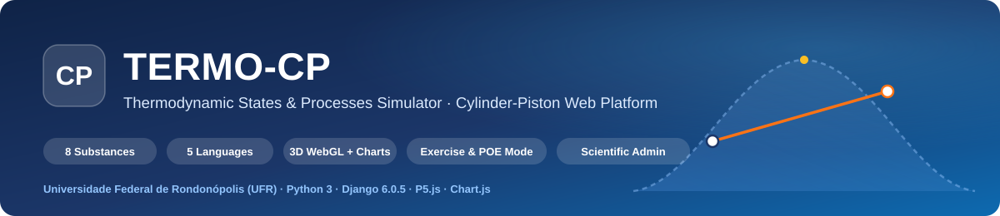
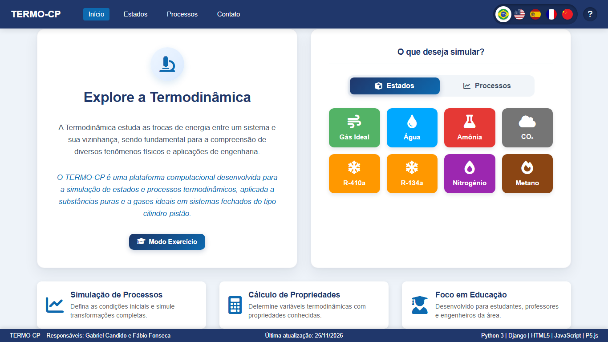

<a name="topo"></a>
<p align="center">
  <a href="https://gcandid0.pythonanywhere.com/">
    
  </a>
</p>

<div align="center">

# TERMO-CP

### Plataforma web para simulação de estados e processos termodinâmicos em sistemas cilindro-pistão.

<sub>🇧🇷 Português &nbsp;|&nbsp; <a href="./README.en.md">🇺🇸 English</a> &nbsp;|&nbsp; <a href="./README.es.md">🇪🇸 Español</a> &nbsp;|&nbsp; <a href="./README.fr.md">🇫🇷 Français</a> &nbsp;|&nbsp; <a href="./README.zh.md">🇨🇳 中文 (简体)</a></sub>

<br/>

<a href="https://gcandid0.pythonanywhere.com/"></a>
<a href="https://www.djangoproject.com/"></a>
<a href="https://www.python.org/"></a>
<a href="https://p5js.org/"></a>
<a href="https://github.com/gcandid0/Termo-CP/blob/main/LICENSE"></a>

<br/>

<a href="https://github.com/gcandid0/Termo-CP/actions/workflows/tests.yml"></a>
<a href="https://github.com/gcandid0/Termo-CP"></a>
<a href="https://github.com/gcandid0/Termo-CP"></a>
<a href="https://github.com/gcandid0/Termo-CP"></a>
<a href="https://github.com/gcandid0/Termo-CP/stargazers"></a>

<br/><br/>

<a href="http://lattes.cnpq.br/6696786236047929"></a>
<a href="https://www.linkedin.com/in/gabriel-candido-235637226/"></a>
<a href="https://github.com/gcandid0/Termo-CP"></a>

</div>

<p align="center"><sub>Desenvolvido no âmbito de pesquisa acadêmica da <strong>Universidade Federal de Rondonópolis (UFR)</strong> · em processo de registro junto ao INPI</sub></p>

## Índice

- [Sobre o TERMO-CP](#sobre-o-termo-cp)
- [Idiomas](#idiomas)
- [Substâncias e Processos Suportados](#substâncias-e-processos-suportados)
- [Funcionalidades](#funcionalidades)
- [Como usar](#como-usar)
- [Testes e Qualidade de Código](#testes-e-qualidade-de-código)
- [Stack Tecnológica](#stack-tecnológica)
- [Roadmap](#roadmap)
- [Contato](#contato)
- [Autores](#autores)
- [Licença](#licença)
- [Como citar](#como-citar)
- [Contribuindo](#contribuindo)

---

## Sobre o TERMO-CP

O **TERMO-CP** é uma plataforma computacional desenvolvida para a simulação de **estados** e **processos termodinâmicos**, aplicada a substâncias puras e a gases ideais em sistemas fechados do tipo cilindro-pistão.

O projeto tem foco educacional, voltado a estudantes, professores e engenheiros que precisam calcular propriedades termodinâmicas, analisar balanços da 1ª e 2ª Leis da Termodinâmica e visualizar transformações de forma rápida, interativa e didática.

**Principais destaques:**

- **Cálculo completo de estados termodinâmicos** — determinação de `P`, `T`, `v`, `u`, `h`, `s`, fase e título `x` (em `%` e fração decimal) a partir de pares de propriedades conhecidas, com massa configurável (`m` em kg).
- **Simulação de processos e encadeamento de ciclos** — cálculo de transformações completas com trabalho (`W`), calor (`Q`), geração de entropia (`Sger`), verificação da 2ª Lei e **Balanço Global do Ciclo** (`W_líq`, `Q_H`, `Q_L`, rendimento térmico `η` e `COP`).
- **Diagramas termodinâmicos interativos com Zoom & Pan** — gráficos `P-v`, `T-s`, `h-s`, `T-v` e `P-h` (eixos lineares e logarítmicos) com domo de saturação, ponto crítico e exportação em PNG/PDF/CSV.
- **Memorial de cálculo didático em PDF** — deduções passo a passo, tabela comparativa Estado 1 × Estado 2, verificação numérica da 1ª Lei, Irreversibilidade de Gouy-Stodola e exportação vetorial em A4.
- **Modo Exercício e Mini-Prova** — gerador de problemas aleatórios por substância e nível, Mini-Prova de 3 questões, trava anti-burla, conversor rápido, código de autenticidade e comprovante/boletim em PDF.
- **Compartilhamento de simulações** — geração de link curto (`/s/<codigo>/`) e QR Code com prévia do cilindro 3D e reabertura direta da simulação pronta no TERMO-CP.
- **Visualização 3D interativa** — animação do conjunto cilindro-pistão em P5.js (WebGL) com régua logarítmica de volume.
- **Histórico, comparação, relatórios e Ajuda contextual** — comparação lado a lado, exportação em PDF/CSV/PNG, Tour Guiado e estatísticas anônimas no painel administrativo.

<br>

<div align="center">
  <a href="https://gcandid0.pythonanywhere.com/">
    
  </a>
</div>

<p align="right"><a href="#topo">↑ voltar ao topo</a></p>

## Idiomas

A plataforma está disponível em **5 idiomas**, selecionáveis diretamente no menu superior (com preferência salva no navegador):

🇧🇷 **Português** &nbsp;|&nbsp; 🇺🇸 **English** &nbsp;|&nbsp; 🇪🇸 **Español** &nbsp;|&nbsp; 🇫🇷 **Français** &nbsp;|&nbsp; 🇨🇳 **中文 (简体)**

<p align="right"><a href="#topo">↑ voltar ao topo</a></p>

## Substâncias e Processos Suportados

| Substância | Estados | Isobárico (`P = cte`) | Isocórico (`v = cte`) | Isentrópico (`s = cte`) | Isotérmico (`T = cte`) | Politrópico (`pvⁿ = cte`) |
|---|:---:|:---:|:---:|:---:|:---:|:---:|
| **Gás Ideal** | ✅ | ✅ | ✅ | ✅ | ✅ | ✅ |
| **Água** | ✅ | ✅ | ✅ | ✅ | — | — |
| **Amônia** | ✅ | ✅ | ✅ | ✅ | — | — |
| **CO₂** | ✅ | ✅ | ✅ | ✅ | — | — |
| **R-410A** | ✅ | ✅ | ✅ | ✅ | — | — |
| **R-134a** | ✅ | ✅ | ✅ | ✅ | — | — |
| **Nitrogênio** | ✅ | ✅ | ✅ | ✅ | — | — |
| **Metano** | ✅ | ✅ | ✅ | ✅ | — | — |

<p align="right"><a href="#topo">↑ voltar ao topo</a></p>

---

## Funcionalidades

### Simulação de Estados
Informe a massa do sistema e duas propriedades conhecidas de uma substância (pressão, temperatura, volume específico, energia interna, entalpia, entropia ou título). O TERMO-CP valida automaticamente os limites físicos de cada tabela termodinâmica, exibe a faixa válida em tempo real e calcula todas as demais propriedades.

### Simulação de Processos e Ciclos
Defina a massa, o estado inicial, o tipo de processo e a condição final (ou calor transferido) para obter o estado final, `W`, `Q` e `Sger` com diagnóstico automático pela 2ª Lei da Termodinâmica. É possível encadear múltiplos processos consecutivos para analisar o **balanço global do ciclo** (`W_líq`, `Q_H`, `Q_L`, `η` e `COP`).

### Visualização 3D e Diagramas Interativos
Cada resultado inclui uma animação 3D do cilindro-pistão em P5.js (com distinção visual entre líquido, vapor e mistura bifásica) e diagramas termodinâmicos interativos com domo de saturação e ponto crítico.

### Memorial Didático, Histórico e Relatórios
- **Memorial de Cálculo (PDF)**: exibe deduções passo a passo da 1ª e 2ª Leis, verificação numérica (`Q − W = ΔU`), Irreversibilidade de Gouy-Stodola (`I = T_viz · Sger`) e exportação vetorial em PDF A4.
- **Diagramas com Zoom & Pan**: ampliação e arraste nativos em Chart.js (eixos lineares e logarítmicos), com exportação em PNG, PDF e CSV.
- **Histórico e Comparação**: guarda os cálculos da sessão com filtro de busca e comparação lado a lado.

### Modo Exercício e Compartilhamento
- **Modo Exercício (`/exercicios/`)**: problemas aleatórios calibrados para cada substância (ou Mini-Prova de 3 questões), análise física por chips clicáveis, trava anti-burla, conversor de unidades, guia de sinais, código de autenticidade no servidor e comprovante/boletim em PDF.
- **Links Compartilháveis (`/s/<codigo>/`)**: gera link curto, QR Code e compartilhamento via WhatsApp/e-mail com prévia dos dados + cilindro 3D com escala e botão para abrir a simulação pronta.

<p align="right"><a href="#topo">↑ voltar ao topo</a></p>

---

## Como usar

> [!IMPORTANT]
> O código-fonte está disponível neste repositório apenas para **visualização e estudo acadêmico**, conforme a [licença](#licença) vigente. Para rodar localmente com fins de pesquisa/avaliação:

**Pré-requisitos:**
- Python 3.10+
- pip

### Instalação local

```bash
# Clone o repositório
git clone https://github.com/gcandid0/Termo-CP.git
cd Termo-CP

# Crie e ative um ambiente virtual
python3 -m venv venv
source venv/bin/activate      # Linux / macOS
# venv\Scripts\activate       # Windows (PowerShell/CMD)

# Instale as dependências
pip install -r requirements.txt

# Configure as variáveis de ambiente (.env)
# crie um arquivo .env na raiz com:
# SECRET_KEY=<sua-chave>
# DEBUG=True

# Rode as migrações e o servidor
python manage.py migrate
python manage.py runserver
```

Acesse `http://127.0.0.1:8000/` no navegador.

**Dependências principais** (`requirements.txt`):

| Pacote | Versão |
|---|---|
| Django | 6.0.5 |
| asgiref | 3.11.1 |
| python-dotenv | 1.2.2 |
| sqlparse | 0.5.5 |
| tzdata | 2026.2 |
| whitenoise | 6.12.0 |

### Uso online

Não é necessário instalar nada — acesse diretamente a versão publicada:

**[gcandid0.pythonanywhere.com →](https://gcandid0.pythonanywhere.com/)**

<p align="right"><a href="#topo">↑ voltar ao topo</a></p>

---

## Testes e Qualidade de Código

O repositório conta com suíte automatizada de testes (Django `TestCase`) e verificação estática via **Ruff**, executados automaticamente no GitHub Actions:

```bash
# Executar os testes automatizados (36 testes: cálculos, views, formulários e integridade UTF-8)
python manage.py test myapp

# Verificação de integridade do projeto Django
python manage.py check

# Análise estática com Ruff (se instalado)
ruff check myapp termocp
```

<p align="right"><a href="#topo">↑ voltar ao topo</a></p>

---

## Stack Tecnológica

- **Backend:** Python 3 + Django 6.0.5 + WhiteNoise
- **Frontend:** HTML5, CSS3, JavaScript, P5.js (WebGL), Chart.js, html2canvas
- **Qualidade & CI:** Django Test Suite + Ruff + GitHub Actions
- **Deploy:** PythonAnywhere
- **Configuração:** python-dotenv (`.env` com `SECRET_KEY` e `DEBUG`)

<p align="right"><a href="#topo">↑ voltar ao topo</a></p>

---

## Roadmap

- [x] Cálculo de estados para 8 substâncias com validação pelos limites exatos das tabelas
- [x] Simulação de processos com animação 3D do cilindro-pistão
- [x] Diagramas termodinâmicos interativos (`P-v`, `T-s`, `h-s`, `T-v`, `P-h`) com domo de saturação
- [x] Memorial de cálculo didático passo a passo e verificação da 2ª Lei
- [x] Encadeamento de processos e Balanço Global do Ciclo (`W_líq`, `Q_H`, `Q_L`, `η`, `COP`)
- [x] Exportação de relatório (`html2canvas`) e histórico comparativo de cálculos
- [x] Central de Ajuda, ajuda contextual e Tour Guiado interativo
- [x] Suporte completo a 5 idiomas (PT / EN / ES / FR / ZH)
- [x] Suíte de testes automatizados e pipeline CI com GitHub Actions
- [x] Zoom & Pan nos diagramas e exportação vetorial em PDF do Memorial Didático
- [x] Modo Exercício (avulso e Mini-Prova de 3 questões) com trava anti-burla e comprovante PDF
- [x] Links compartilháveis de simulação (QR Code, prévia 3D com escala e reabertura direta)
- [x] Estatísticas anônimas de uso e auditoria de exercícios no Django Admin
- [x] Modo Exercício com 3 modalidades (Avulso, Mini-Prova e Método POE Completo), Código de Turma, Calculadora de Interpolação e Validador Público (`/exercicios/validar/`)
- [x] Painel Científico no Django Admin (6 gráficos PNG com rótulos, texto automático para artigos, tabelas Word/LaTeX e filtro por turma)
- [x] Endurecimento de segurança (CSRF nas APIs, rate limit, honeypot, HTTPS/HSTS, `ADMIN_URL` configurável e `pip-audit` no CI)
- [x] Otimização Mobile completa (cabeçalho em 2 linhas, resultados 3D e Relatório Final fullscreen no celular)

<p align="right"><a href="#topo">↑ voltar ao topo</a></p>

---

## Contato

Dúvidas, sugestões ou relatos de problemas podem ser enviados pelo [formulário de contato](https://gcandid0.pythonanywhere.com/contato/) da plataforma, por [issues no GitHub](https://github.com/gcandid0/Termo-CP/issues) ou diretamente pelos e-mails abaixo.

## Autores

Projeto desenvolvido no âmbito de pesquisa acadêmica da **Universidade Federal de Rondonópolis (UFR)**:

- **Gabriel Candido Messias dos Santos** — [gabrielcandidomds@gmail.com](mailto:gabrielcandidomds@gmail.com) · [Lattes](http://lattes.cnpq.br/6696786236047929) · [LinkedIn](https://www.linkedin.com/in/gabriel-candido-235637226/)
- **Fábio Basaglia Fonseca** — [fabio.fonseca@ufr.edu.br](mailto:fabio.fonseca@ufr.edu.br) · [Lattes](http://lattes.cnpq.br/4673164208199862)

## Licença

O TERMO-CP está em **processo de registro junto ao INPI** (Lei nº 9.609/1998 e Lei nº 9.610/1998) e seus direitos autorais são reservados aos autores e à UFR.

Até a conclusão do registro e definição formal dos termos de licenciamento:

- ✅ É permitida a **visualização e o estudo** do código-fonte para fins acadêmicos, de pesquisa e avaliação, sem fins comerciais.
- ❌ **Não é permitida**, sem autorização expressa e por escrito dos autores: reprodução, distribuição, modificação, criação de obras derivadas, uso comercial, sublicença ou cessão de direitos.

O software é fornecido "no estado em que se encontra", sem garantias de qualquer tipo. Veja o texto completo em [LICENSE](LICENSE).

## Como citar

Se o TERMO-CP for utilizado em trabalhos acadêmicos, você pode citá-lo em diferentes formatos:

<details>
<summary><strong>ABNT</strong></summary>

```
SANTOS, Gabriel Candido Messias dos; FONSECA, Fábio Basaglia. TERMO-CP:
plataforma computacional para simulação de estados e processos termodinâmicos.
Rondonópolis: Universidade Federal de Rondonópolis (UFR), <ano>. Disponível
em: https://gcandid0.pythonanywhere.com/. Acesso em: <data>.
```
</details>

<details>
<summary><strong>APA</strong></summary>

```
Santos, G. C. M., & Fonseca, F. B. (<ano>). TERMO-CP: plataforma computacional
para simulação de estados e processos termodinâmicos [Software]. Universidade
Federal de Rondonópolis. https://gcandid0.pythonanywhere.com/
```
</details>

<details>
<summary><strong>Vancouver</strong></summary>

```
Santos GCM, Fonseca FB. TERMO-CP: plataforma computacional para simulação de
estados e processos termodinâmicos [Internet]. Rondonópolis: Universidade
Federal de Rondonópolis; <ano> [citado <data>]. Disponível em:
https://gcandid0.pythonanywhere.com/
```
</details>

<details>
<summary><strong>IEEE</strong></summary>

```
G. C. M. Santos and F. B. Fonseca, "TERMO-CP: plataforma computacional para
simulação de estados e processos termodinâmicos," Universidade Federal de
Rondonópolis (UFR), <ano>. [Online]. Disponível:
https://gcandid0.pythonanywhere.com/
```
</details>

<details>
<summary><strong>BibTeX</strong></summary>

```bibtex
@software{termo_cp,
  author  = {Santos, Gabriel Candido Messias dos and Fonseca, Fábio Basaglia},
  title   = {TERMO-CP: plataforma computacional para simulação de estados e
             processos termodinâmicos},
  year    = {<ano>},
  institution = {Universidade Federal de Rondonópolis (UFR)},
  url     = {https://gcandid0.pythonanywhere.com/},
  note    = {Acesso em: <data>}
}
```
</details>

<details>
<summary><strong>RIS</strong> (Zotero, Mendeley, EndNote)</summary>

```
TY  - COMP
AU  - Santos, Gabriel Candido Messias dos
AU  - Fonseca, Fábio Basaglia
TI  - TERMO-CP: plataforma computacional para simulação de estados e processos termodinâmicos
PY  - <ano>
PB  - Universidade Federal de Rondonópolis (UFR)
UR  - https://gcandid0.pythonanywhere.com/
ER  -
```
</details>

## Contribuindo

Contribuições são bem-vindas, respeitando os termos da [licença](#licença) — em especial, entre em contato com os autores antes de propor alterações de código. Veja o guia completo em [CONTRIBUTING.md](CONTRIBUTING.md).

<p align="right"><a href="#topo">↑ voltar ao topo</a></p>

---

> [!WARNING]
> O TERMO-CP tem finalidade educacional e os resultados devem ser validados antes de aplicações de engenharia críticas. O software encontra-se em processo de registro no INPI e é distribuído sob termos restritivos — consulte a [Licença](#licença) antes de qualquer uso além de visualização e estudo.

<br>

<div align="center">
  
  <br>
  <sub>
    <strong>TERMO-CP</strong> · desenvolvido na <a href="https://www.ufr.edu.br/">Universidade Federal de Rondonópolis (UFR)</a><br>
    <a href="https://gcandid0.pythonanywhere.com/">Plataforma</a> ·
    <a href="https://github.com/gcandid0/Termo-CP">GitHub</a> ·
    <a href="http://lattes.cnpq.br/6696786236047929">Lattes</a> ·
    <a href="https://www.linkedin.com/in/gabriel-candido-235637226/">LinkedIn</a> ·
    <a href="mailto:gabrielcandidomds@gmail.com">Contato</a>
  </sub>
</div>
