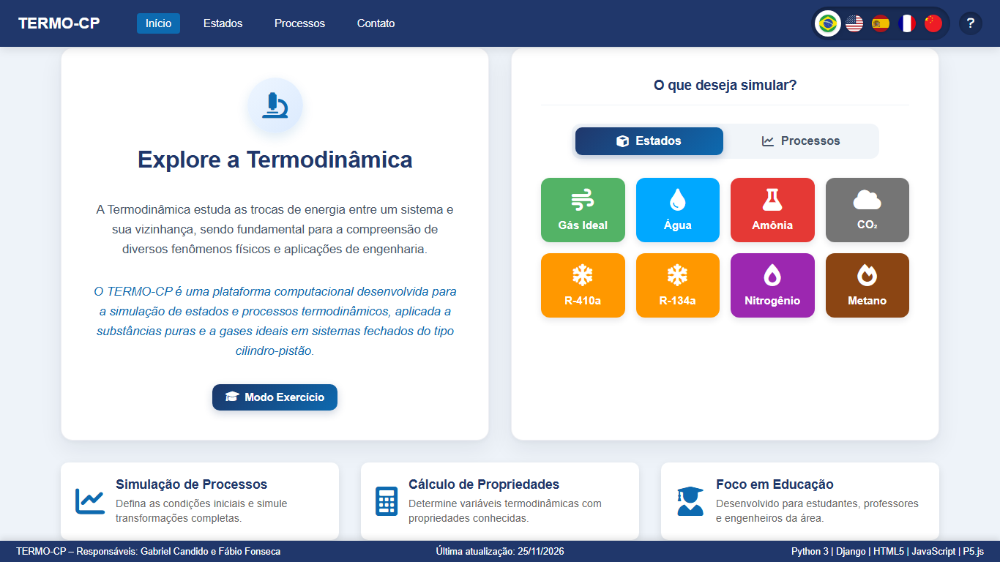

<a name="top"></a>
<p align="center">
  <a href="https://gcandid0.pythonanywhere.com/">
    
  </a>
</p>

<div align="center">

# TERMO-CP

### 用于模拟活塞-气缸系统中热力学状态与过程的 Web 计算平台。

<sub><a href="./README.md">🇧🇷 Português</a> &nbsp;|&nbsp; <a href="./README.en.md">🇺🇸 English</a> &nbsp;|&nbsp; <a href="./README.es.md">🇪🇸 Español</a> &nbsp;|&nbsp; <a href="./README.fr.md">🇫🇷 Français</a> &nbsp;|&nbsp; 🇨🇳 中文 (简体)</sub>

<br/>

<a href="https://gcandid0.pythonanywhere.com/"></a>
<a href="https://www.djangoproject.com/"></a>
<a href="https://www.python.org/"></a>
<a href="https://p5js.org/"></a>
<a href="https://github.com/gcandid0/Termo-CP/blob/main/LICENSE"></a>

<br/>

<a href="https://github.com/gcandid0/Termo-CP/actions/workflows/tests.yml"></a>
<a href="https://github.com/gcandid0/Termo-CP/stargazers"></a>
<a href="https://github.com/gcandid0/Termo-CP/commits/main"></a>
<a href="https://github.com/gcandid0/Termo-CP"></a>
<a href="https://github.com/gcandid0/Termo-CP/issues"></a>

<br/><br/>

<a href="http://lattes.cnpq.br/6696786236047929"></a>
<a href="https://www.linkedin.com/in/gabriel-candido-235637226/"></a>
<a href="https://github.com/gcandid0/Termo-CP"></a>

</div>

<p align="center"><sub>由<strong>龙多诺波利斯联邦大学 (UFR)</strong> 学术研究项目开发 · 正在向巴西国家工业产权局 (INPI) 申请软件著作权登记</sub></p>

## 目录

- [关于 TERMO-CP](#关于-termo-cp)
- [支持语言](#支持语言)
- [支持的物质与过程](#支持的物质与过程)
- [核心功能](#核心功能)
- [快速开始](#快速开始)
- [测试与代码质量](#测试与代码质量)
- [技术栈](#技术栈)
- [路线图](#路线图)
- [联系我们](#联系我们)
- [作者](#作者)
- [许可证](#许可证)
- [引用方式](#引用方式)
- [参与贡献](#参与贡献)

---

## 关于 TERMO-CP

**TERMO-CP** 是一款面向闭口活塞-气缸系统的热力学 Web 仿真平台，支持对纯物质与理想气体的热力学**状态**和**过程**进行高精度计算与交互式可视化。

本项目面向高校学生、教师及工程技术人员，旨在帮助用户快速计算热力学性质、分析热力学第一与第二定律平衡，并直观理解系统变化过程。

**主要亮点：**

- **完整的热力学状态计算** — 根据任意两个有效已知属性，自动求解 `P`、`T`、`v`、`u`、`h`、`s`、相态及干度 `x`（同时以百分比 `%` 和小数形式展示），支持自定义系统质量（`m`，单位 kg）。
- **过程模拟与循环串联** — 计算完整热力学变化，输出功（`W`）、热量（`Q`）、熵产（`Sger`）、热力学第二定律可行性判定，以及**循环全局平衡**（净功 `W_net`、吸热量 `Q_H`、放热量 `Q_L`、热效率 `η` 与制冷系数 `COP`）。
- **交互式热力学图表** — 支持 `P-v`、`T-s`、`h-s`、`T-v`、`P-h` 图表，并绘制饱和穹顶与临界点。
- **教学推导计算书** — 针对每个过程展示热力学第一、第二定律的分步理论推导与公式。
- **3D 交互式动画** — 基于 P5.js (WebGL) 的活塞-气缸 3D 动态演示，配备体积滑块实时观察变化。
- **历史对比与报告导出** — 保存会话计算记录以便并排对比，并支持使用 `html2canvas` 一键导出报告图片。
- **上下文帮助与交互引导** — 内置完整帮助中心、逐页提示以及按钮与结果的交互式引导游览。

<br>

<div align="center">
  <a href="https://gcandid0.pythonanywhere.com/">
    
  </a>
</div>

<p align="right"><a href="#top">↑ 返回顶部</a></p>

## 支持语言

平台支持 **5 种语言**，可在顶部导航栏随时一键切换（浏览器自动记住偏好设置）：

🇧🇷 **Português** &nbsp;|&nbsp; 🇺🇸 **English** &nbsp;|&nbsp; 🇪🇸 **Español** &nbsp;|&nbsp; 🇫🇷 **Français** &nbsp;|&nbsp; 🇨🇳 **中文 (简体)**

<p align="right"><a href="#top">↑ 返回顶部</a></p>

## 支持的物质与过程

| 物质 | 状态计算 | 等压 (`P = 常数`) | 等容 (`v = 常数`) | 等熵 (`s = 常数`) | 等温 (`T = 常数`) | 多变 (`pvⁿ = 常数`) |
|---|:---:|:---:|:---:|:---:|:---:|:---:|
| **理想气体** | ✅ | ✅ | ✅ | ✅ | ✅ | ✅ |
| **水 (H₂O)** | ✅ | ✅ | ✅ | ✅ | — | — |
| **氨 (NH₃)** | ✅ | ✅ | ✅ | ✅ | — | — |
| **二氧化碳 (CO₂)** | ✅ | ✅ | ✅ | ✅ | — | — |
| **R-410A** | ✅ | ✅ | ✅ | ✅ | — | — |
| **R-134a** | ✅ | ✅ | ✅ | ✅ | — | — |
| **氮气 (N₂)** | ✅ | ✅ | ✅ | ✅ | — | — |
| **甲烷 (CH₄)** | ✅ | ✅ | ✅ | ✅ | — | — |

<p align="right"><a href="#top">↑ 返回顶部</a></p>

---

## 核心功能

### 状态模拟
输入系统质量及两个已知热力学属性（压力、温度、比容、内能、焓、熵或干度）。TERMO-CP 会根据各物质热力学性质表的精确边界自动校验输入范围并实时提示有效区间，随即计算出全部其余属性。

### 过程与循环模拟
设定质量、初始状态、过程类型及终态条件（或传递热量），即可求得终态属性、`W`、`Q`、`Sger` 以及基于热力学第二定律的可行性判断。支持串联多个连续过程以计算**循环全局平衡**（`W_net`、`Q_H`、`Q_L`、`η` 与 `COP`）。

### 3D 可视化与交互式图表
每个计算结果均配有 P5.js 3D 活塞-气缸动画（清晰区分液相、气相和气液两相混合物），并提供带饱和穹顶与临界点的交互式热力学图表。

### 教学计算书、历史记录与报告
- **教学计算书**：分步展示适用于当前过程的热力学第一、第二定律理论推导过程。
- **历史与对比**：在浏览器中自动保存当前会话的计算记录，支持多组结果并排对比。
- **报告导出**：生成汇总报告，并通过 `html2canvas` 导出为图片，便于附入实验报告与学术作业。

<p align="right"><a href="#top">↑ 返回顶部</a></p>

---

## 快速开始

> [!IMPORTANT]
> 本仓库中的源代码依据现行[许可证](#许可证)仅限用于**学术浏览与学习研究**。如需在本地运行以供科研或评估使用：

**环境要求：**
- Python 3.10+
- pip

### 本地安装

```bash
# 克隆仓库
git clone https://github.com/gcandid0/Termo-CP.git
cd Termo-CP

# 创建并激活虚拟环境
python3 -m venv venv
source venv/bin/activate      # Linux / macOS
# venv\Scripts\activate       # Windows (PowerShell/CMD)

# 安装依赖
pip install -r requirements.txt

# 配置环境变量 (.env)
# 在项目根目录创建 .env 文件并填写：
# SECRET_KEY=<your-secret-key>
# DEBUG=True

# 执行数据库迁移并启动开发服务器
python manage.py migrate
python manage.py runserver
```

在浏览器中访问 `http://127.0.0.1:8000/`。

**主要依赖** (`requirements.txt`)：

| 依赖包 | 版本 |
|---|---|
| Django | 6.0.5 |
| asgiref | 3.11.1 |
| python-dotenv | 1.2.2 |
| sqlparse | 0.5.5 |
| tzdata | 2026.2 |
| whitenoise | 6.12.0 |

### 在线体验

无需任何安装，直接访问线上版本：

**[gcandid0.pythonanywhere.com →](https://gcandid0.pythonanywhere.com/)**

<p align="right"><a href="#top">↑ 返回顶部</a></p>

---

## 测试与代码质量

本仓库包含自动化测试套件（Django `TestCase`）以及 **Ruff** 静态代码检查，并通过 GitHub Actions 自动运行：

```bash
# 运行自动化测试（共 28 项测试：热力学计算、视图、表单与 UTF-8 编码完整性）
python manage.py test myapp

# 运行 Django 系统检查
python manage.py check

# 使用 Ruff 进行静态检查（如已安装）
ruff check myapp termocp
```

<p align="right"><a href="#top">↑ 返回顶部</a></p>

---

## 技术栈

- **后端：** Python 3 + Django 6.0.5 + WhiteNoise
- **前端：** HTML5、CSS3、JavaScript、P5.js (WebGL)、Chart.js、html2canvas
- **质量与 CI：** Django Test Suite + Ruff + GitHub Actions
- **部署：** PythonAnywhere
- **配置管理：** python-dotenv（包含 `SECRET_KEY` 与 `DEBUG` 的 `.env` 文件）

<p align="right"><a href="#top">↑ 返回顶部</a></p>

---

## 路线图

- [x] 支持 8 种物质的状态计算与精确热力学性质表边界校验
- [x] 带 3D 活塞-气缸动画的过程仿真
- [x] 带饱和穹顶的交互式热力学图表（`P-v`、`T-s`、`h-s`、`T-v`、`P-h`）
- [x] 分步教学推导计算书与热力学第二定律判定
- [x] 多过程串联与循环全局平衡（`W_net`、`Q_H`、`Q_L`、`η`、`COP`）
- [x] 报告导出（`html2canvas`）与计算历史并排对比
- [x] 帮助中心、上下文页面帮助与交互式引导游览
- [x] 完整支持 5 种语言（PT / EN / ES / FR / ZH）
- [x] 自动化测试套件与 GitHub Actions CI 流水线

<p align="right"><a href="#top">↑ 返回顶部</a></p>

---

## 联系我们

如有疑问、建议或发现错误，欢迎通过平台[联系表单](https://gcandid0.pythonanywhere.com/contato/)、提交 [GitHub Issue](https://github.com/gcandid0/Termo-CP/issues) 或直接发送邮件与我们联系。

## 作者

本项目由**龙多诺波利斯联邦大学 (UFR)** 学术研究团队开发：

- **Gabriel Candido Messias dos Santos** — [gabrielcandidomds@gmail.com](mailto:gabrielcandidomds@gmail.com) · [Lattes](http://lattes.cnpq.br/6696786236047929) · [LinkedIn](https://www.linkedin.com/in/gabriel-candido-235637226/)
- **Fábio Basaglia Fonseca** — [fabio.fonseca@ufr.edu.br](mailto:fabio.fonseca@ufr.edu.br) · [Lattes](http://lattes.cnpq.br/4673164208199862)

## 许可证

TERMO-CP 正在向巴西 **INPI 申请软件注册**（依据巴西第 9.609/1998 号与第 9.610/1998 号法律），全部版权归作者及 UFR 所有。

在登记完成并正式公布许可条款之前：

- ✅ 允许在非商业前提下**查阅与学习**源代码，用于学术研究、教学与评估。
- ❌ 未经作者书面明确授权，**禁止**复制、分发、修改、创建衍生作品、商业使用、再许可或转让权利。

本软件按“现状”提供，不附带任何形式的担保。完整条款请参阅 [LICENSE](LICENSE)。

## 引用方式

如您在学术论文或研究报告中使用了 TERMO-CP，可按以下任意格式引用：

<details>
<summary><strong>ABNT</strong></summary>

```
SANTOS, Gabriel Candido Messias dos; FONSECA, Fábio Basaglia. TERMO-CP:
plataforma computacional para simulação de estados e processos termodinâmicos.
Rondonópolis: Universidade Federal de Rondonópolis (UFR), <年份>. Disponível
em: https://gcandid0.pythonanywhere.com/. Acesso em: <日期>.
```
</details>

<details>
<summary><strong>APA</strong></summary>

```
Santos, G. C. M., & Fonseca, F. B. (<年份>). TERMO-CP: computational platform
for simulating thermodynamic states and processes [Software]. Federal University
of Rondonópolis. https://gcandid0.pythonanywhere.com/
```
</details>

<details>
<summary><strong>Vancouver</strong></summary>

```
Santos GCM, Fonseca FB. TERMO-CP: computational platform for simulating
thermodynamic states and processes [Internet]. Rondonópolis: Federal University
of Rondonópolis; <年份> [cited <日期>]. Available from:
https://gcandid0.pythonanywhere.com/
```
</details>

<details>
<summary><strong>IEEE</strong></summary>

```
G. C. M. Santos and F. B. Fonseca, "TERMO-CP: computational platform for
simulating thermodynamic states and processes," Federal University of
Rondonópolis (UFR), <年份>. [Online]. Available:
https://gcandid0.pythonanywhere.com/
```
</details>

<details>
<summary><strong>BibTeX</strong></summary>

```bibtex
@software{termo_cp,
  author  = {Santos, Gabriel Candido Messias dos and Fonseca, Fábio Basaglia},
  title   = {TERMO-CP: computational platform for simulating thermodynamic
             states and processes},
  year    = {<年份>},
  institution = {Federal University of Rondonópolis (UFR)},
  url     = {https://gcandid0.pythonanywhere.com/},
  note    = {Accessed on: <日期>}
}
```
</details>

<details>
<summary><strong>RIS</strong> (Zotero, Mendeley, EndNote)</summary>

```
TY  - COMP
AU  - Santos, Gabriel Candido Messias dos
AU  - Fonseca, Fábio Basaglia
TI  - TERMO-CP: computational platform for simulating thermodynamic states and processes
PY  - <年份>
PB  - Federal University of Rondonópolis (UFR)
UR  - https://gcandid0.pythonanywhere.com/
ER  -
```
</details>

## 参与贡献

欢迎在遵守[许可证](#许可证)条款的前提下提出建议与反馈——在提交代码更改前请先联系作者。详见 [CONTRIBUTING.md](CONTRIBUTING.md)。

<p align="right"><a href="#top">↑ 返回顶部</a></p>

---

> [!WARNING]
> TERMO-CP 主要用于教学与科研目的，应用于关键工程场景前请务必对计算结果进行独立校核。本软件正在办理 INPI 登记并受限于严格许可条款，除查阅与学习外请先参阅[许可证](#许可证)。

<br>

<div align="center">
  
  <br>
  <sub>
    <strong>TERMO-CP</strong> · 开发于 <a href="https://www.ufr.edu.br/">龙多诺波利斯联邦大学 (UFR)</a><br>
    <a href="https://gcandid0.pythonanywhere.com/">在线平台</a> ·
    <a href="https://github.com/gcandid0/Termo-CP">GitHub</a> ·
    <a href="http://lattes.cnpq.br/6696786236047929">Lattes</a> ·
    <a href="https://www.linkedin.com/in/gabriel-candido-235637226/">LinkedIn</a> ·
    <a href="mailto:gabrielcandidomds@gmail.com">联系我们</a>
  </sub>
</div>
